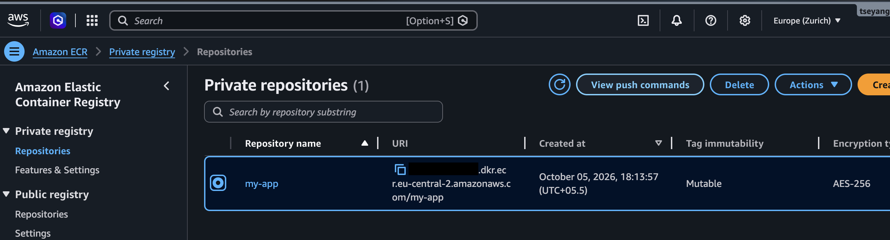

# Deploy from a Private Docker Registry to Kubernetes

## Description

Deploy a web application in a Minikube cluster by pulling its image from a private Amazon ECR repository. This takes two parts: a **Secret** (`kubernetes.io/dockerconfigjson`) holding the registry credentials, and a **Deployment** that references it through `imagePullSecrets`.

The image (`my-app`) was pushed to ECR in a previous project: [aws-ecr-docker-push](https://gitlab.com/Tseyang/aws-ecr-docker-push).

## Technologies Used

- Kubernetes (Minikube)
- Helm
- AWS ECR (Elastic Container Registry)
- Docker
- AWS CLI
- kubectl

## Prerequisites

- Minikube running, with `kubectl` pointing to it
- AWS CLI configured with access to your AWS account
- A private ECR repository containing an image (here: `my-app`, region `eu-central-2`)



> Replace `<AWS_ACCOUNT_ID>` and `<TAG>` in all commands with your own values.

## Steps

### 1. Authenticate Docker against ECR

In the ECR console, open the repository and click **View push commands**. The first command gets an authentication token and logs Docker in:

```bash
aws ecr get-login-password --region eu-central-2 | \
  docker login --username AWS --password-stdin <AWS_ACCOUNT_ID>.dkr.ecr.eu-central-2.amazonaws.com
```

Docker stores the result in `~/.docker/config.json`. On the host this file only has empty entries, because the credentials live in the OS credential store (`credsStore: desktop`). Minikube runs in its own VM/container and **cannot access that store**, so the host's config is of no use to the cluster. You have to log in from inside Minikube instead.


### 2. Log in to the registry from inside Minikube

```bash
minikube ssh
pwd    # /home/docker

docker login --username AWS --password <TOKEN> <AWS_ACCOUNT_ID>.dkr.ecr.eu-central-2.amazonaws.com
```

`<TOKEN>` is the output of `aws ecr get-login-password --region eu-central-2`, run on the host. Docker warns that `--password` on the CLI is insecure; `--password-stdin` is the safer choice.

Minikube now has a `.docker/config.json` that contains the authorization token:

```bash
ls -a
cat .docker/config.json
```


> **Note:** ECR tokens are valid for **12 hours**. After that, repeat steps 1-4 to refresh the Secret, otherwise new pods fail with `ImagePullBackOff`.

### 3. Copy the config file from Minikube to the host

```bash
minikube cp minikube:/home/docker/.docker/config.json ./config.json
```

> **Warning:** Do not copy it to `~/.docker/config.json`. That overwrites your host's Docker config. Keep it in the project folder and add it to `.gitignore`, since it contains credentials.

If you want to write the Secret as YAML, base64-encode the file:

```bash
cat config.json | base64
```


### 4. Create the Docker registry Secret

Use **one** of the options below. The Secret must be in the **same namespace** as the Deployment.

**Option A: from the config file** (can hold credentials for multiple registries)

```bash
kubectl create secret generic my-registry-key \
  --from-file=.dockerconfigjson=config.json \
  --type=kubernetes.io/dockerconfigjson
```

**Option B: from a YAML file** (`docker-secret.yaml`)

```yaml
apiVersion: v1
kind: Secret
metadata:
  name: my-registry-key
data:
  .dockerconfigjson: <base64 output from step 3>
type: kubernetes.io/dockerconfigjson
```

```bash
kubectl apply -f docker-secret.yaml
```

**Option C: for a single registry** (credentials passed directly)

```bash
kubectl create secret docker-registry my-registry-key-two \
  --docker-server=<AWS_ACCOUNT_ID>.dkr.ecr.eu-central-2.amazonaws.com \
  --docker-username=AWS \
  --docker-password=$(aws ecr get-login-password --region eu-central-2)
```

Verify the Secret exists:

```bash
kubectl get secret
```


### 5. Configure the Deployment

In `my-app-deployment.yaml`, give the Deployment access to the Secret with `imagePullSecrets`, and set `imagePullPolicy: Always` so the image is pulled fresh from the registry:

```yaml
apiVersion: apps/v1
kind: Deployment
metadata:
  name: my-app
spec:
  replicas: 1
  selector:
    matchLabels:
      app: my-app
  template:
    metadata:
      labels:
        app: my-app
    spec:
      imagePullSecrets:
      - name: my-registry-key
      containers:
      - name: my-app
        image: <AWS_ACCOUNT_ID>.dkr.ecr.eu-central-2.amazonaws.com/my-app:<TAG>
        imagePullPolicy: Always
        ports:
        - containerPort: 3000
```

### 6. Deploy and verify

```bash
kubectl apply -f my-app-deployment.yaml
kubectl get pods
```


Confirm the image was pulled from the private registry:

```bash
kubectl describe pod <pod-name>
```

The **Events** section shows `Pulling image` followed by `Successfully pulled image`.


## Troubleshooting

| Symptom | Likely cause |
|---|---|
| `ImagePullBackOff` / `ErrImagePull` | Token expired (12h), wrong Secret name, or Secret in a different namespace than the Deployment |
| `no basic auth credentials` | The Secret contains the host's config (empty `auths`) instead of Minikube's |

## Security Notes

- Never commit `config.json`, its base64 output, or ECR tokens to Git.
- Blur or crop account IDs and tokens in screenshots before publishing.